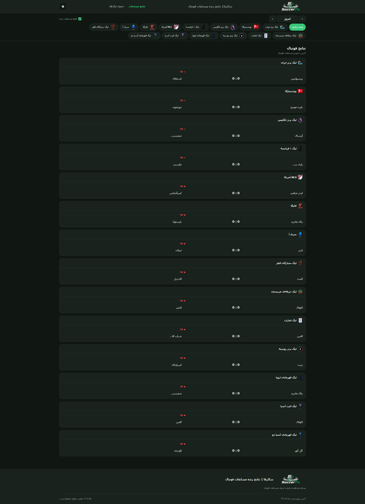
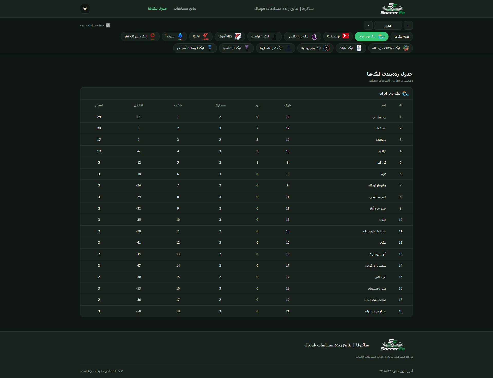

# ⚽ ساکرفا | soccerFa

**دموی آنلاین نمایش نتایج زنده و جدول رده‌بندی لیگ‌های فوتبال**

این پروژه با استفاده از HTML، CSS و JavaScript خالص توسعه داده شده و برای اجرا به هیچ فریم‌ورکی نیاز ندارد.

## ✨ امکانات و قابلیت‌ها

- 📺 نمایش نتایج زنده مسابقات با به‌روزرسانی خودکار هر ۳۰ ثانیه
- 📅 امکان مشاهده مسابقات و نتایج روز گذشته، امروز و فردا
- ⏭ نمایش خودکار مسابقات آینده در صورت نبود بازی در روز جاری
- ⏱ نمایش شمارش معکوس تا زمان شروع مسابقات
- 🏆 نمایش جدول رده‌بندی ۱۴ لیگ فوتبال
- 🌙 پشتیبانی از پوسته روشن و تاریک با ذخیره‌سازی تنظیمات در `localStorage`
- ♿ رعایت اصول دسترس‌پذیری، شامل `aria-live`، `focus-visible` و `reduced-motion`
- 📱 طراحی کاملاً واکنش‌گرا (Responsive) و سازگار با دستگاه‌های مختلف

## 🏗 ساختار و معماری پروژه

پروژه از چهار بخش اصلی تشکیل شده است:

- `config.js` ← مدیریت تنظیمات و فهرست لیگ‌ها (منبع اصلی تنظیمات)
- `api.js` ← مدیریت لایه دریافت داده‌ها در حالت‌های آزمایشی (Mock) و اتصال به API (HTTP)
- `app.js` ← مدیریت منطق رابط کاربری و وضعیت برنامه (State Management)
- `style.css` ← مدیریت استایل‌ها با استفاده از متغیرهای CSS

## 🔄 حالت‌های دریافت داده

پروژه از دو حالت برای دریافت داده‌ها پشتیبانی می‌کند:

- `provider: 'mock'` ← حالت پیش‌فرض؛ نمایش اطلاعات آزمایشی بدون نیاز به بک‌اند
- `provider: 'http'` ← اتصال به API واقعی؛ به دلیل محدودیت‌های CORS، استفاده از یک پراکسی سمت سرور (Backend Proxy) ضروری است.

## 🧠 تصمیم‌های فنی و نکات پیاده‌سازی

- **نمایش خودکار مسابقات آینده (Fallback):** در صورتی که برای روز جاری مسابقه‌ای وجود نداشته باشد، تابع `getFixtures()` فراخوانی می‌شود تا مسابقات آینده نمایش داده شود.

- **جلوگیری از تداخل درخواست‌ها (Race Condition):** با استفاده از `requestId` از نمایش داده‌های قدیمی و بازنویسی نتایج جدید توسط درخواست‌های قبلی جلوگیری می‌شود.

- **سیستم کش (Cache):** اطلاعات جدول‌های رده‌بندی به مدت ۵ دقیقه ذخیره می‌شوند تا از درخواست‌های تکراری جلوگیری شود.

- **امنیت خروجی‌ها:** با استفاده از تابع `esc()` خروجی‌ها ایمن‌سازی می‌شوند. همچنین برای آدرس تصاویر و منابع، از فهرست مجاز (Allowlist) استفاده شده است.

- **جلوگیری از نشت حافظه (Memory Leak):** پس از هر بار رندر، تابع `prunePrev()` شناسه‌های مربوط به عناصر حذف‌شده را پاک‌سازی می‌کند.

## 🚀 راه‌اندازی و اجرا

برای اجرای پروژه نیازی به نصب وابستگی یا فریم‌ورک خاصی نیست.

**روش اول: اجرای مستقیم**  
کافی است فایل `index.html` را با مرورگر خود باز کنید.

**روش دوم: اجرا با سرور محلی**  
ابتدا دستور زیر را در ترمینال و در مسیر اصلی پروژه اجرا کنید:

npx serve .
## Screenshots

  
  

